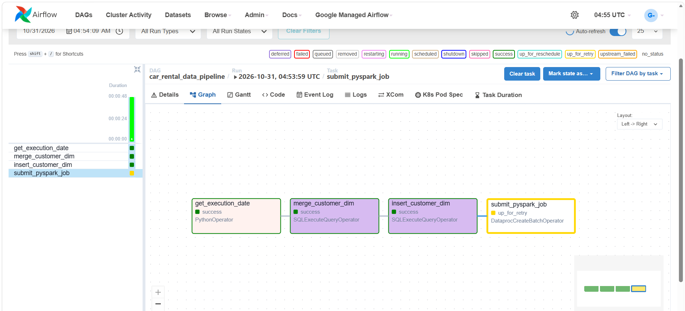
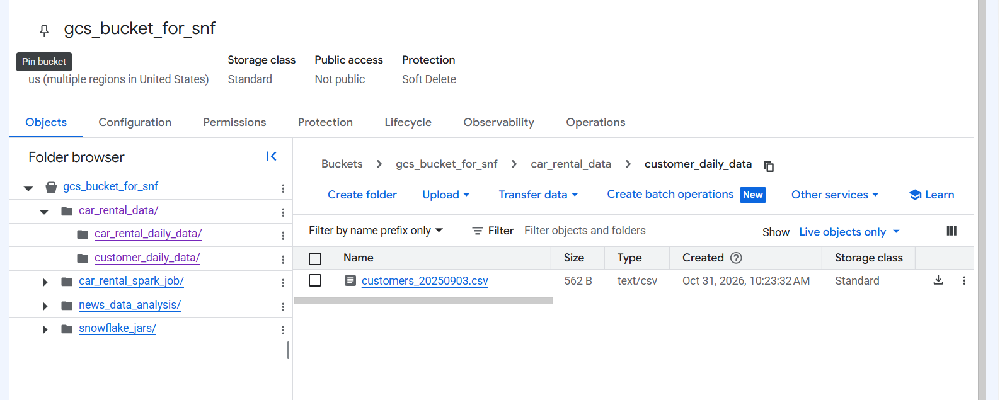
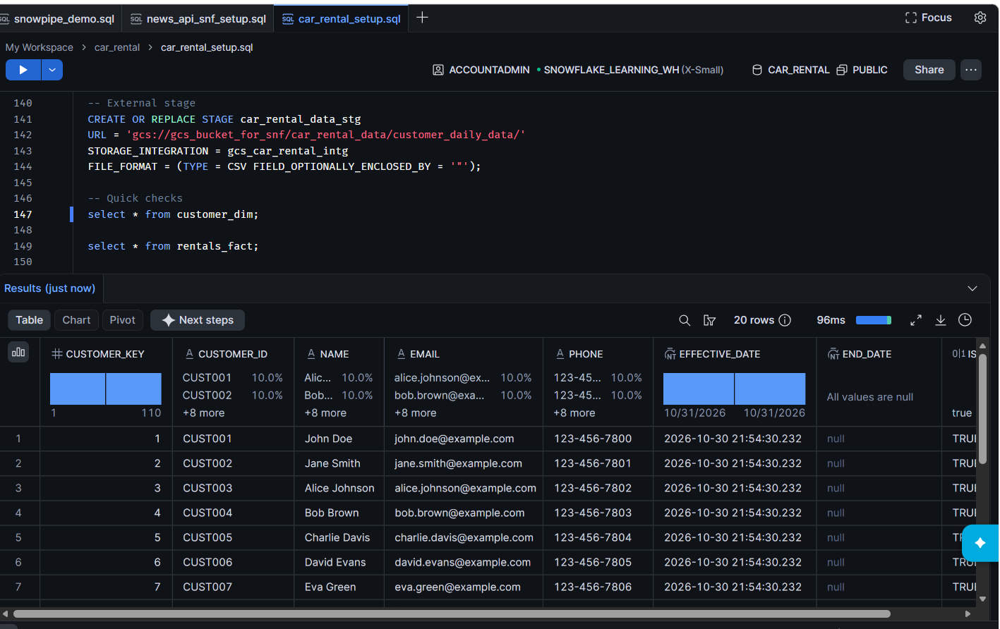

# Car Rental Data Pipeline

An Apache Airflow pipeline on Google Cloud Composer orchestrates customer data loading and car-rental fact processing. Customer CSV data is staged from Google Cloud Storage into Snowflake, customer dimension records are maintained as a slowly changing dimension (SCD Type 2), and a PySpark job processes rental JSON data and loads the resulting facts into Snowflake. The PySpark job runs as a Dataproc Serverless batch.

## Pipeline overview

1. The Airflow DAG resolves the processing date from its `execution_date` parameter, falling back to the Airflow logical date.
2. The DAG merges customer records from the date-specific CSV in the Snowflake external stage, closing out changed current dimension records.
3. The DAG inserts the current customer dimension rows.
4. The DAG submits the PySpark job to Dataproc Serverless. The job reads the date-specific rental JSON from GCS, validates and transforms the records, joins them with Snowflake dimensions, and appends the results to `rentals_fact`.

The DAG is in [`airflow_dags/`](airflow_dags/), the Spark application is in [`spark_job/`](spark_job/), and the GitHub Actions deployment workflow is in [`.github/workflows/deploy-dags.yml`](.github/workflows/deploy-dags.yml).

## Screenshots

### Airflow pipeline

The Airflow graph shows the customer dimension tasks followed by the Dataproc Serverless batch task.

### GCS customer data

Customer CSV files are stored in the `customer_daily_data/` bucket folder and are read by the Snowflake external stage.

### Snowflake customer dimension

Example query results for the Snowflake `customer_dim` table.

## Setup

### 1. Google Cloud

1. Enable the Cloud Composer and IAM Service Account Credentials APIs.
2. Create the Composer environment with a service account that has the **Composer Worker** role.
3. Create a `github-deployer` service account with:
   - **Storage Object Admin** on the Composer DAG bucket
   - A role that allows `composer.environments.get`
4. Create a Workload Identity Pool (`github-pool`) and OIDC provider (`github-provider`):
   - Issuer: `https://token.actions.githubusercontent.com`
   - Attribute mapping: `google.subject = assertion.sub`, `attribute.repository = assertion.repository`
   - Condition: `assertion.repository_owner == 'Ashutosh1104'` (allows any repo owned by this GitHub account)
5. Allow the repository to impersonate `github-deployer` (**Workload Identity User** role):
   - On the pool, choose **Grant access** > service account impersonation, select `github-deployer`
   - Attribute name: `repository`, value: `Ashutosh1104/news_api_data_airflow_snowflake_gcp`
   - The provider condition only checks the owner, so this per-repo binding is what restricts which repository can use the service account.

#### Adding another repository

Reuse the same pool and provider. No new pool is needed.

1. Repeat step 5 with the new repo's name (`Ashutosh1104/<new-repo>`).
2. Use `github-deployer` if it deploys to the same Composer environment. Otherwise create a separate service account with only the roles it needs and bind the new repo to that.
3. Add the same `WIF_PROVIDER` secret and the matching `GCP_SA_EMAIL` secret in the new repo.

### 2. GitHub

Add these repository secrets (Settings > Secrets and variables > Actions):

| Secret | Value |
|---|---|
| `WIF_PROVIDER` | `projects/<PROJECT_NUMBER>/locations/global/workloadIdentityPools/github-pool/providers/github-provider` |
| `GCP_SA_EMAIL` | `github-deployer@<PROJECT_ID>.iam.gserviceaccount.com` |

Optional repository variables: `COMPOSER_ENV`, `COMPOSER_REGION` (defaults are set in the workflow). The deployer service account also needs **Storage Object Admin** access to the bucket containing `gs://gcs_bucket_for_snf/car_rental_spark_job/`.

### 3. Composer environment

- In the Composer environment's PyPI packages configuration, install `apache-airflow-providers-snowflake`.
- In the Airflow UI for Composer, open Admin > Variables and add a variable with key `NEWS_API_KEY` and value set to your NewsAPI API key. The fetch task reads the key from this Airflow Variable; it is separate from the Snowflake connection.
- In the Airflow UI for Composer, open Admin > Connections and create the Snowflake connection with ID `snowflake_conn`, which is the ID used by the DAG. Do not commit credentials to the repo.
- The DAG renders this connection's login and password into the Dataproc Spark job arguments. They may be visible in Airflow task data or Dataproc job metadata/logs; move them to Secret Manager before treating the deployment as production-safe.
- To store Airflow connection credentials in Google Secret Manager, configure Secret Manager as the Airflow secrets backend and enable billing for the Google Cloud project. A free-tier account without billing enabled cannot use this setup; use Composer's Airflow Connections UI if you are not configuring Secret Manager.

## Usage

1. Add or edit DAGs in `airflow_dags/` or Spark job files in `spark_job/`. Place customer CSV inputs under the configured GCS `customer_daily_data/` prefix and rental JSON inputs under `car_rental_data/car_rental_daily_data/`, using the expected date-based filenames.
2. Push changes in either folder to `main`.
3. The **Deploy DAGs** workflow syncs DAGs to Composer and Spark job files to `gs://gcs_bucket_for_snf/car_rental_spark_job/`. Both syncs remove remote files that are not present in their corresponding repository folder.
4. DAGs appear in the Airflow UI within a couple of minutes. Spark job files are available in GCS for Dataproc Serverless.

The DAG submits Spark work as a Dataproc Serverless batch in `us-central1` (runtime `2.2`), rather than using a persistent Dataproc cluster. Ensure the batch's runtime service account can read the script, connector JARs, and input data from GCS and can reach Snowflake. The Snowflake Spark connector JAR must be compatible with the Serverless runtime's Spark version.

To deploy manually: GitHub > Actions > Deploy DAGs > Run workflow.

To run the DAG manually, trigger `car_rental_data_pipeline` in Airflow and optionally provide an `execution_date` in `yyyymmdd` format. Leave it as `NA` to use the Airflow logical date.